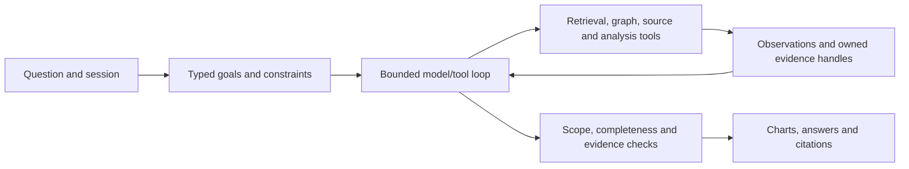

# TrialScope

**Clinical-trial analysis with inspectable evidence and reproducible agent experiments.**

TrialScope turns questions about registered studies into interactive charts and cited text answers. A bounded LangGraph tool loop reads intermediate results before choosing the next query, analysis or clarification. Deterministic code calculates statistics; immutable source snapshots preserve the evidence behind them.

The project also studies two questions: **which evidence should enter an agent's context, and can reusable procedures improve how the agent works?** Experiments live separately from the default application, with frozen inputs, explicit controls and retained failures.

[Try recorded examples](#try-it-without-credentials) · [Run the service](#run-the-full-service) · [Research](#research) · [Technical documentation](#technical-documentation)

## What it does

- Analyze phases, enrollment, countries, dates and sponsor–drug relationships through bars, trends, histograms, scatter plots, maps and networks.
- Discover entities from one result and use them in subsequent comparisons; preserve and explicitly revise follow-up constraints.
- Explore streamed progress, history, explanations, contributors, quotations, exports and revocable shares in React/TypeScript/ECharts.
- Resolve sourced entity aliases, read ClinicalTrials.gov records and PubMed abstracts, and expose the registered tool layer through HTTP, CLI and MCP.

## Try it without credentials

Requires Python 3.12+ and Node.js 24. Create a Python environment:

```sh
python -m venv .venv
```

Activate it with `source .venv/bin/activate` on macOS/Linux or `.\.venv\Scripts\Activate.ps1` in PowerShell, then:

```sh
python -m pip install -r requirements.lock
python -m pip install --no-deps -e .
npm --prefix frontend ci
npm --prefix frontend run build
python -m uvicorn scripts.view_recorded_examples:create_app --factory --host 127.0.0.1 --port 8013
```

Open <http://127.0.0.1:8013/>. The read-only viewer verifies and displays five preserved V2 model turns, including a follow-up and a medicine comparison. Click chart values to inspect contributors and download the original results, traces and evidence. These are recorded executions on frozen data; the viewer makes no new model or database calls. [Demo guide](docs/DEMO.md) · [Recording provenance](examples/v2/README.md).

## Run the full service

With Docker available, create `.env` from `.env.example` if you do not already have one. Configure `OPENAI_API_KEY`, an accessible `OPENAI_MODEL`, and your own `NEO4J_PASSWORD`. Keep the experiment flags false; OpenRouter is optional for separate research commands.

```sh
docker compose up --build -d
```

Open <http://127.0.0.1:8000/>; API documentation is at `/docs`. Compose builds the frontend and starts Neo4j with persistent volumes. For a native Neo4j installation, configure its URI and credentials, build the frontend as above, then run:

```sh
python -m uvicorn app.main:create_app --factory --host 127.0.0.1 --port 8000
```

Try: “For melanoma studies involving pembrolizumab, show phase counts with complete contributor evidence.” The `/v2/runs` API exposes status and replayable events; `/analyze` remains compatible. Default V2 limits are 18 model calls, 24 tool calls, 900 seconds and an estimated/reserved $2 model budget. [API contract](docs/API.md) · [Configuration](docs/VNEXT.md).

## Architecture and evidence



ClinicalTrials.gov snapshots are hashed and immutable. Neo4j projects retrieved populations into dataset-scoped graphs. Registered tools enforce scope and calculate chart values without executing model-generated code. SQLite stores runs, tool journals and evidence for replay and recovery.

Passage selection never shrinks a statistical population. Incomplete acquisition cannot silently become complete; official-count mode labels sampled evidence separately. Chart values link to contributing studies and original fields. Quotations must match fields actually read, with source identity and hashes attached.

These checks establish specific invariants. Valid quotations can still fail to support an interpretation, and task understanding can fail. [Design and verification](docs/DESIGN.md).

## Research

Results below belong to frozen execution versions. Different benchmarks measure different capabilities and are never pooled into one success rate. Failures remain in their planned denominators.

| Study | Research question | Status and evidence |
|---|---|---|
| [Core300](docs/CORE300_RESULTS.md) | Scope, dependent analysis and verifiable statistics. | **Closed:** 295/300 overall; 196/200 heldout. Template-derived tasks span 15 disease–drug groups, including 10 heldout groups. A dependency-linkage audit changed no grades. |
| [TrialQA adaptation](docs/TRIALQA_PROTOCOL.md#completed-formal-study) | Finding records versus receiving source handles. | **Closed:** given sources vs frozen retrieval achieved 96/120 vs 95/120 citation-supported correct answers; both achieved 64/79 heldout. Retrieval covers 102 frozen records. The automated judge is fallible; this is a project adaptation, not an official LABBench2 score. |
| [NLI4CT evidence selection](docs/NLI4CT_RESULTS.md) | Fixed-budget evidence selection versus full source context. | **Closed:** 500 official test questions and the same frozen 200-question answer subset across five conditions; all completed. Jev retained complete evidence on 300/500 and answered 141/200 correctly. Full context: 500/500 and 160/200, with no 1024-token cap. |
| [Harness transfer](docs/HARNESS_V3_PROTOCOL.md) | Do edited procedures and historical experience help beyond a strong baseline and budget-matched attempts? | **Ongoing:** 40 planned tasks across four conditions. Final transfer, experience-use and cost results pending; no partial grades reported. |

Core300's small number of groups and repeated templates limit generalization. TrialQA did not establish a difference or equivalence between its two conditions. All 237 published TrialQA answers passed exact quotation checks, yet 20 answers judged correct lacked sufficient quoted support for all material claims. This motivates separate evaluation of answer correctness, citation support and source integrity.

### NLI4CT: evidence selection under a context budget

| Method | Complete necessary evidence / 500 | Correct answers / same 200 |
|---|---:|---:|
| Hybrid retrieval | 279 | 135 |
| Dedicated MiniLM reranker | 291 | 138 |
| Jev | 300 | 141 |
| Luna | 288 | 132 |
| Full source text, budget-exempt | 500 | 160 |

Jev improved complete-evidence coverage over hybrid retrieval by **4.2 percentage points** (paired shared-trial cluster-bootstrap 95% interval **+2.0 to +6.8**). Its answer difference was **+3.0 points**, with an interval crossing zero (**−0.6 to +6.8**). Against Luna, the answer difference was **+4.5 points** (**+0.8 to +8.8**); against MiniLM it was **+1.5 points** (**−2.4 to +6.5**). These exploratory comparisons use 113 shared-trial components and no multiplicity correction; they support a configuration-specific finding, not universal Jev superiority.

Full text achieved the strongest answer result, but uses more information and is exempt from the 1024-token selection limit; its complete evidence coverage is guaranteed by supplying all source sentences. Budgeted methods share a maximum 24-candidate pool and packer. This tests selection within supplied trial materials, not whole-corpus recall. The result motivates comparing evidence compression with simply reading all available material when practical. Citation membership and label correctness do not prove semantic citation support.

NLI costs including pilot, aborted run and recovery were **$4.227937 estimated/reserved**, including **$0.079918** retained for ten unknown-usage attempts; these are not invoices. The formal run alone was **$4.075859 estimated/reserved**. Recovery preserved quality denominators, excluded six interrupted case/arm timings, and retained all original attempts. Formal timing has asymmetric client overhead; use the separate latency control below for that question.

The [complete report](docs/NLI4CT_RESULTS.md) provides paired intervals, input strata and cost reconciliation. An [independent source-level audit](docs/public-evaluation/nli4ct-independent-audit.json) reconstructed all 2,500 case/arm rows from official records with zero discrepancies. Public sanitized case metrics support reproducing aggregate and paired statistics. Repeating the source-level audit also requires the local official dataset and saved study outputs; those raw materials are not published here.

Earlier [small passage-selection experiments](docs/PASSAGE_SELECTION_RESULTS.md) did not establish Jev's advantage over a cheap model or trial-ID scope rules. Missing candidates limit every reranker; connection reuse also changes observed latency. The [fairness analysis](docs/JEV_FAIRNESS_REVIEW.md) and [controlled latency probe](docs/JEV_LATENCY_CONTROL.md) keep these effects separate from answer quality.

Harness²-inspired experiments modify bounded procedures and context/experience policies. Adoption or fewer final calls alone does not demonstrate learning: editor costs, failed probes, task performance and budget-matched controls matter. Recursive self-improvement has not been established.

Protocols pin data, splits, models and execution source. Reports retain failed attempts and unknown-usage budget reservations. Crash recovery is disclosed separately for [NLI4CT](docs/NLI4CT_RECOVERY_REPORTING.md) and [Harness](docs/HARNESS_V3_PROTOCOL.md#desktop-crash-and-recovery-amendment--2026-11-01). Restricted benchmark materials remain local; public reports omit their original questions, passages and gold answers.

Most recently verified [CI at `5cd1b73`](https://github.com/Techarl/ClinitalTrials_Query-to-Visualization_Agent/actions/runs/41307232230) passed **969 Python tests**, with **3 skips and no expected failures**, plus **14 frontend tests** and the frontend build. This identifies the checked revision; subsequent report changes require their own checks.

## Verify and explore

With the Python environment activated:

```sh
python -m app.verify_examples
python -m scripts.verify_v2_examples
python -m pytest -q
python -m pip check
npm --prefix frontend test
```

The two example verifiers run offline against preserved raw records. Graph tests require a configured isolated Neo4j instance and `--live-neo4j`; optional dataset tests may skip. Live research commands are separate and can incur API charges. Tests and example verification do not replace model-quality evaluation.

## Technical documentation

- [Agent workflow and tool surface](docs/VNEXT.md), [API and export contracts](docs/API.md), [design and limitations](docs/DESIGN.md).
- [Public evaluation protocols](docs/PUBLIC_EVALUATION.md), [Core300 dependency audit](docs/CORE300_SELECTION_AUDIT.md), and the study reports linked above.
- [Interactive demo](docs/DEMO.md), [recorded examples](examples/v2/README.md), [UI acceptance](docs/UI_REVIEW_FIXES.md), and [release validation](docs/release/source-validation.json).

## Scope, provenance and AI assistance

This single-user local service has one execution worker, no authentication and bounded budgets. Source drift, upstream availability, ambiguity, missing fields and unsupported operations remain limits. Registry co-occurrence does not establish treatment effects or sponsor collaboration. Experimental experience banks do not continuously modify the default application.

OpenAI Codex assisted extensively with code, prompts, tests, reference checks and documentation. AI-assisted implementations and checkers can share conceptual mistakes; source identities, traces and negative findings remain available for inspection.

A fixed historical release remains available at **[submission-v1](https://github.com/Techarl/ClinitalTrials_Query-to-Visualization_Agent/tree/submission-v1)** (`77791d7`). Its submitted artifact and verification records remain separate from subsequent personal-project research.
