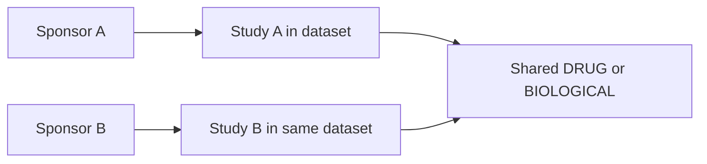

# 醒来后的检查与演示

主服务地址：[API 文档](http://127.0.0.1:8000/docs)。基础版本已经修复第一轮 R1–R9 和第二轮 F1–F4，完整记录见 [修复对照](ROUND2_REVIEW_RESPONSE.zh-CN.md)。API 默认仍为 baseline；研究实验由独立命令运行。

## 先看三个结果

1. [Phase 3 年趋势](../examples/02_followup_trend/response.json)：继承 melanoma/pembrolizumab，改为 Phase 3、2015–2025 开始年份。冻结数据中 27 项研究；`meta.analysis_scope`、metric 和 assumptions 与最终计划一致。
2. [跨药物比较](../examples/03_comparison/response.json)：asthma 中 dupilumab 与 omalizumab 分组；来源为 60 与 116 条，组间允许重叠。
3. [共享药物 sponsor 网络](../examples/05_shared_drugs/response.json)：rheumatoid arthritis/adalimumab；两侧 sponsor 的研究必须属于同一个快照范围。边权是共享干预实体数，证据支持研究数单独记录。

这些是冻结观察值。实时来源更新后，新的完整快照可能产生不同数量。

## 在 API 文档演示两轮

在 `POST /analyze` 输入：

```json
{"query":"Show the phase distribution of melanoma studies involving pembrolizumab.","language":"en"}
```

从响应复制 session_id 和 run_id，再提交：

```json
{
  "query":"Keep the condition and drug, only Phase 3, and show studies starting each year from 2015 through 2025.",
  "session_id":"替换为上一轮 session_id",
  "parent_run_id":"替换为上一轮 run_id",
  "language":"en"
}
```

观察第二轮计划保留原疾病/药物；过滤条件新增阶段与年份；operation 改为 time_series；历史说明不会继续写“按阶段统计、不限制开始年份”。

## 打开一个数据点的证据

图表每行有 evidence_set_id。访问 `GET /evidence/{id}?offset=0&limit=3`，可看到该点的贡献 NCT、dataset_id、来源链接和带精确值的 JSON Pointer。`next_offset` 表示还有后续证据，预览条数不是完整贡献数量。

再访问 `GET /datasets/{dataset_id}/studies/{nct_id}`，检查原始记录的对应字段。离线导出的 `response.evidence.json` 已包含完整证据，不依赖运行中的数据库。

## 如何解释架构

GPT 提出 typed plan；固定代码校验条件和能力边界；ClinicalTrials.gov 完整分页抓取并冻结 JSON；Neo4j 保存范围内的图投影并查询；Python 固定算子装配图表和证据。LLM 不计算计数、不编造引用，也不自由生成 Cypher/Python。

Neo4j 的代表性路径是：



共享干预不等于 sponsor 合作；同研究出现两种药也不证明处于同一治疗臂。

LangGraph 的 plan → validate → execute 三个节点足够表达当前流程；确定性的分页、导入、统计和证据操作在执行服务内部。SQLite 保存会话/运行/证据，LangGraph 保存 checkpoint。完成结果与会话变更原子提交；恢复不会重置原始 deadline 或已尝试的模型调用数。

## 验证证据与边界

- 本机、Linux 与 GitHub CI 跑确定性回归；研究边界加入后为 109 项。本机与容器都包括真实 Neo4j fixture。
- 独立 raw JSON oracle 检查完整预期项集合；26 种符合 schema 的故意破坏必须失败。
- 语义评测与数值 oracle 分开。48 个工程编写 case / 50 轮，保留的 planner-v2 发布版为 49/50，之前两遍分别为 49/50 与 50/50；差异为全站请求的 unsupported/clarify 状态选择；小样本、单遍结果不能视为广泛稳定准确率。
- 全新 Compose 数据卷和 ZIP 独立安装/启动也已验证。

剩余限制包括 broad source search 的 5,000 条预算、词语/品牌/缩写消歧、仅按开始年份过滤、同步单 worker、无认证/保留期清理、无前端。完整统计不能用向量 top-k 代替；数据源错误也不能被当成零条研究。

## 两个实验与混合检索

阅读 [实验记录](EXPERIMENTS.md) 和各自完整 JSON。当前决策回放中，额外 GPT gate 没有提升已全部正确的 baseline；固定 Jev gate 策略出现过度澄清。BM25/embedding/RRF 提供有来源的候选，但没有证明可以自动确认医学实体。受限 Harness² 保留 PPC 与经验库及多样本对照，评分答案不进入优化运行时。多轮转录的因果边界单独披露。

演示时应解释实验方法、成本和观察结果，不把“接入了模型/框架”本身当成有效性证明。

第二轮收尾新增定向真实联调：scope 冲突先澄清，当前显式改为 comparison 后成功得到 400/396 两组研究。该两轮联调不是新一遍语义 benchmark。当前修复和历史实验分开记录，见 [第二轮修复对照](ROUND3_REVIEW_RESPONSE.zh-CN.md)。
