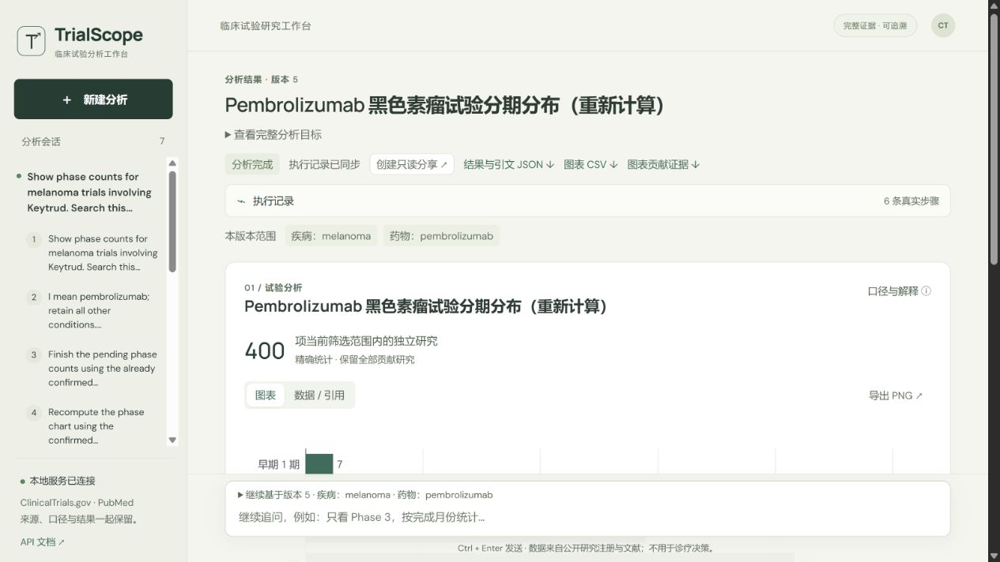
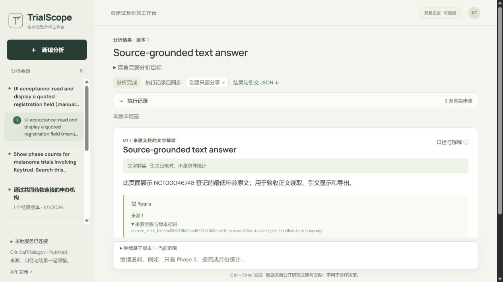
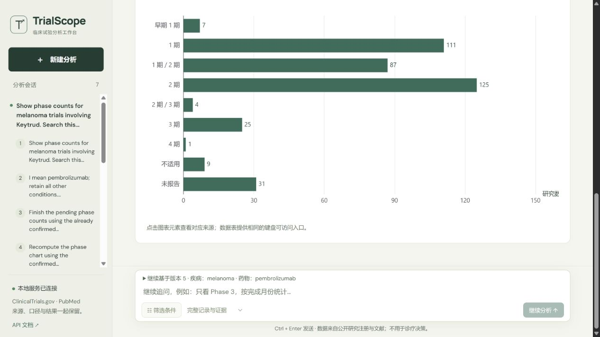
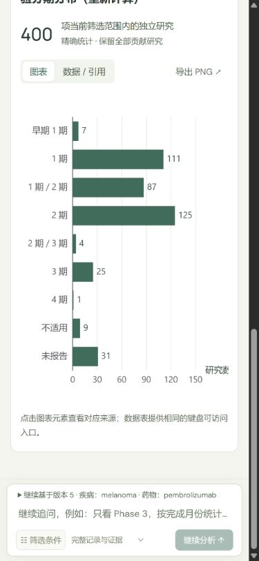

# UI review fixes and browser acceptance

Validated on 2026-11-01 against the local HTTP service at `127.0.0.1:8001`, using existing saved runs. This UI acceptance used no paid model calls.

## Changes

- Submissions acquire a synchronous guard before the first await. A UUID submission key is retained after a transport failure for retry, replaced when the payload changes, and cleared on success. The backend separately enforces atomic idempotency.
- History groups runs by session, preserving each result version and marking historical branches. The composer states which version and conditions a follow-up inherits. Switching runs clears unsubmitted filters, dates, acquisition mode and question text.
- Phase charts use horizontal bars, complete category labels and visible values. Joint phases remain joint categories. Single-series legends are hidden. The count caption identifies independent studies in the active scope.
- Evidence drawers name the selected category or relationship, comparison group and value. Loading and errors are separate states; request generations reject stale selection or pagination responses. Each contributing study remains accessible, with raw source fields folded to avoid overwhelming the panel.
- Explanations describe metrics, date fields, exclusions and evidence completeness in prose. Full metadata remains available under advanced details.
- The composer is compact until focused or filters are expanded. Table mode disables PNG export and points to CSV export.
- Narrow-screen drawers set background content inert, move focus inside, trap Tab/Shift+Tab, close on Escape and return focus to the triggering control.
- Qualitative answer artifacts display answer text, exact quoted excerpts, source handles/pointers and limitations. They are explicitly distinguished from population statistics; quotation integrity does not claim semantic entailment.
- Main visual/answer artifacts precede supporting identity mappings. The concise result title leads the page; the complete task remains under an expandable disclosure. Empty follow-up controls expand on focus, while entered text keeps the controls available.
- JSON export includes result text and quotations. Chart CSV and contributor-evidence links appear only when corresponding chart/evidence data exists; text-only results do not offer empty chart exports.

## Automated verification

`npm run build` passed (TypeScript and Vite production build). Vite retains its pre-existing chart-bundle size warning; the build succeeds.

`npm test`: 7 tests passed. Covered synchronous duplicate-submit protection, retry-key reuse and replacement, session/branch grouping, scope and joint-phase wording, selected data-point identity, network endpoint identity, qualitative answer wording, and stale evidence/pagination response rejection.

## Live browser acceptance

Desktop default viewport and a temporary **390 × 844** mobile viewport were tested. The viewport override was reset afterward.

- Existing melanoma/pembrolizumab phase run `vr_cafd8a7ebec6472b9e7eda8be169da35`: all nine labels and values visible, including combined phases and missing values; no redundant single-series legend.
- Table mode: PNG button visibly disabled. Phase 3 opens **25** contributors; Phase 4 opens **1**, with the correct selected point heading and source trial `NCT03715205`.
- Mobile focus: drawer opens on its close button; Shift+Tab wraps to the last available source-details control; Tab wraps back to close; Escape closes the drawer and returns focus to the originating citation button.
- Draft filter reset: entered `asthma`, `United States` and official-count mode, then selected the saved psoriasis history. Draft fields became empty, mode returned to full evidence, and inherited scope displayed `psoriasis` / `secukinumab`.
- Mobile phase labels and numeric values remain visible at 390 px. The evidence drawer fills the small viewport without exposing background controls.
- Captured browser warning/error log was empty.

Transport failure, delayed-response races and duplicate keyboard entry are checked by deterministic tests of the production guard logic. This browser acceptance did not deliberately produce an extra paid analysis or inject a network failure.

A later real HTTP manual-tool smoke read `NCT00046748`'s registered `minimumAge` field, published the exact quotation `12 Years`, and finalized a qualitative artifact. The browser displayed the excerpt and source pointer, with JSON export and without empty CSV/contributor exports. [The receipt](public-evaluation/ui-reading-smoke.json) records zero model calls. This is a source-reader/UI mechanism check, not an Agent answer-quality result. The manual provenance limitation is visible in the answer.

## Screenshots

[Full desktop result page](screenshots/ui-review/phase-desktop-full.png)

