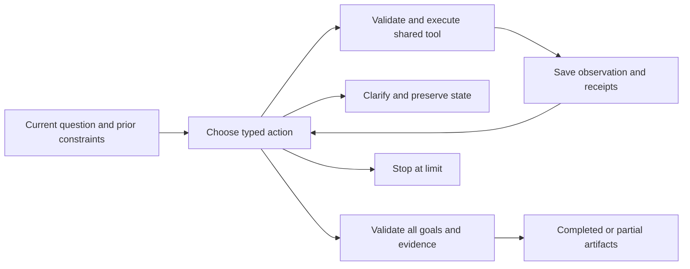

# VNext analysis workspace

V2 adds an observation-driven agent and a React/TypeScript/ECharts client while retaining the v1 API and historical examples. See [release source validation](release/source-validation.json), [UI acceptance](UI_REVIEW_FIXES.md), and the [public evaluation guide](PUBLIC_EVALUATION.md). The earlier [research results](VNEXT_RESEARCH.md) retain their original execution versions and limits.

## Start the workspace

Install the Python dependencies as described in the root README, fill the existing local `.env`, and start Neo4j. Node 24 is used for the frontend build:

```powershell
npm --prefix frontend ci
npm --prefix frontend run build
.venv/Scripts/python.exe -m uvicorn app.main:create_app --factory --host 127.0.0.1 --port 8000
```

Open <http://127.0.0.1:8000/>. Alternatively, `docker compose up --build -d` builds both frontend and backend. The project remains a single-user local/self-hosted service, with one execution worker; it is not a public authenticated multi-tenant service. The development frontend is `npm --prefix frontend run dev`, proxying to API port 8001.

```powershell
.venv/Scripts/python.exe -m app.v2.cli "For psoriasis studies involving secukinumab, plot enrollment against duration using exact start and completion dates." --output data/scatter.json
```

The CLI exports the same result package and complete contributor evidence. Keep both experiment flags false for ordinary use. OpenAI is the main planner; optional OpenRouter credentials are used only by explicitly invoked research commands. Optional `NCBI_EMAIL` and `NCBI_API_KEY` identify PubMed requests. Keys stay in `.env` and never in shared results, logs or source receipts.

## Execution and contracts

The model first defines typed goals and constraints, then chooses one registered tool. The graph executes it, saves a public observation, and calls the model again to select the next action. A simple question can finish after search and analysis; a ranking task derives scope handles from the actual returned entities before calculating trends.



`TaskSpec` records separate goals, their dependencies and requested chart parameters. `RunResult.artifacts[]` binds each result to scope, metric, encoding, coverage, advisories, evidence and dependencies. A valid old chart cannot satisfy a new population or changed chart parameters. Default limits are 18 model calls, 24 data-tool calls, 900 seconds, 50,000 full records and $2 estimated/reserved main-model cost. Unknown usage remains reserved. List-rate estimates are not invoices.

Every attempt is journaled before invocation, and its receipt is saved before advancing the action. Completed identical tool inputs replay their result; interrupted external attempts remain recorded. Terminal state, session-head update and final event commit atomically. A concurrent completed branch remains accessible without replacing the newer session head. Startup resubmits unfinished automatic runs with their original deadlines; explicit resume is also available. Manual MCP/tool sessions are never automatically converted to paid model runs.

`submission_id` makes transport retries idempotent: the same key and payload return one run, while a reused key with different input is rejected. Completed model receipts replay even when the new-call allowance is exhausted. Cancellation is rechecked after a model reply. Every requested comparison cohort must be present once, with labels bound to actual identities, before a result can complete.

For textual questions, `lookup_trials` returns record handles for reading, `read_source` reads bounded source-field pages, and `publish_text_answer` retains exact quotations actually observed by the Agent. A sampled reading search is never a statistical population. Quotation integrity is checked deterministically; the model's interpretation is a separate semantic claim. JSON/share views retain these excerpts, while CSV and contributor exports apply to charts.

`search_experiences`, `read_skill` and `apply_skill` let the executor read and activate immutable procedures when useful. Engineering seeds and experiment-learned lessons have separate provenance. Negative lessons are readable but cannot activate. Reading or applying a component is a mechanism observation, not evidence that it improved the answer.

## Data and interpretation

- Full-evidence mode checks complete pagination, official totals, unique NCT IDs, raw hashes and source versions. Wide acquisition uses disjoint study-type partitions including an explicit unknown/other complement; overlap, changing versions or an incomplete union cannot publish a statistic.
- Official-count overview requires explicit mode selection. Only mutually exclusive status or study-type buckets are supported. Each count has a saved official response; up to three citation samples per bucket are explicitly labelled. Exact numbers do not imply complete contributor evidence.
- Official CTgov search semantics, including its synonyms, define the source universe. Record filters then define the analytical scope. A curated drug mapping or explicit `otherNames` supports identity resolution; fuzzy similarity supplies candidates only. Ingredient, formulation and combination names are not automatically merged.
- Date filters are independent of the chart's time axis. Start, primary completion, completion and first posted dates retain precision and ACTUAL/ESTIMATED type. A coarse source date interval must be wholly inside a range. Year-only dates are excluded from monthly charts; duration uses exact nonnegative start-to-completion days. Missing records and reasons are reported.
- Country counts are memberships, not necessarily a partition. A country bar and map use the same result and evidence. Natural Earth geography is public-domain; unmapped names remain visible. A renderer switch never changes the underlying metric.
- Network co-occurrence is at study level, not proof of same-arm combination therapy. Shared sponsor drugs are not evidence of collaboration. Ranking uses the full scoped graph, not the clipped display. Role-specific supporting records remain available.
- PubMed is separate literature metadata and available abstracts. NCT mentions are explicit text links, not proof of efficacy or full-text review. Corrections/retractions supplied by NCBI are preserved. A literature failure can leave a valid trial chart in a partial result.

Independent validators recompute complete rows, edges, nodes, date periods and scatter coordinates from raw records; histogram contributors also satisfy the output intervals directly. Official counts and literature are checked against their immutable receipts. Explanation panels use validated metric metadata; free-form model numerical prose is not presented as a verified result.

## HTTP and interaction

| Endpoint | Purpose |
|---|---|
| `POST /v2/runs` | Submit query; receive run/session IDs immediately |
| `GET /v2/runs/{id}` | Authoritative status and result artifacts |
| `GET /v2/runs/{id}/events` | Durable SSE; `Last-Event-ID` or `after` replays missed events |
| `POST /v2/runs/{id}/resume` | Resume original run, or supply a new question with its explicit parent |
| `POST /v2/runs/{id}/cancel` | Cancel at a safe execution boundary |
| `GET /v2/results/{id}/evidence` | Owned result/item citations with offset/limit |
| `GET /v2/runs/{id}/export` | Full result JSON (including quoted text), chart CSV, or chart contributor evidence |
| `POST /v2/runs/{id}/share` | Immutable read-only local share snapshot |
| `DELETE /v2/runs/{id}/shares/{token}` | Revoke a share |
| `GET /s/{token}` | Read-only page; no session write controls |
| `POST /v2/tool-sessions`, `/v2/tools/{name}` | Typed direct calls through the same registry |
| `GET /capabilities` | Schemas, source modes, chart/date capabilities and limits |

Click bars, points, nodes or edges to open the precise contributor set. The data table offers the same evidence actions for keyboard users. History, explicit filters, date bounds and the source mode are available in the workspace. Sharing copies only the selected result package and its public-source evidence; private prompts, model responses, usage and session IDs are excluded. Links point to this local/self-hosted installation, not a newly deployed public site.

## MCP

Both transports use official MCP SDK 2.3.0 and the same registry, budgets, owned handles and validation as HTTP:

```powershell
.venv/Scripts/python.exe -m app.v2.mcp_server --transport stdio
.venv/Scripts/python.exe -m app.v2.mcp_server --transport http --port 8002
.venv/Scripts/python.exe -m scripts.vnext_mcp_smoke --transport stdio
.venv/Scripts/python.exe -m scripts.vnext_mcp_smoke --transport http
```

The HTTP endpoint is `http://127.0.0.1:8002/mcp`. A client first calls `create_tool_session` with a `TaskSpec`; it receives a run ID and an ephemeral access token. Pass both on subsequent calls. A different token cannot read/use that run. Tokens live only in the server instance and do not expose HTTP write access. `cancel_run` requests cancellation; evidence accepts paging. Manual tools perform no hidden planner calls. Server restarts invalidate MCP access tokens; HTTP persisted runs remain available locally.

## Evaluation and research

`evaluation/cases_v2.json` contains new grouped episodes; old 50-turn results are retained separately. Frozen CTgov records and PubMed receipts define replay coverage. An uncovered request returns `replay_coverage_missing`, never zero records. Future dialogue turns and hidden semantic labels are not in runtime prompts. The split is entity-disjoint; capability templates intentionally recur, so this is not a template-disjoint generalization claim.

```powershell
# No paid calls:
.venv/Scripts/python.exe -m pytest --live-neo4j -q
.venv/Scripts/python.exe -m app.verify_examples
# Explicitly paid, isolated research:
.venv/Scripts/python.exe -m evaluation.run_v2 --split development
.venv/Scripts/python.exe -m experiments.decision_v2
.venv/Scripts/python.exe -m experiments.harness_v2
```

The decision study separates semantic repair from genuine user clarification and compares composite/full, atomic/full, atomic/compact, generative/compact and fixed checks. Harness executes actual tools and evidence, proposes bounded reusable procedures/context policies, probes candidates, composes and reruns, and separately records retrieval/application/adoption. Strong H0, matched call-budget retries and a fixed manual procedure are controls. Research results and limitations are published only after the actual runs finish.
